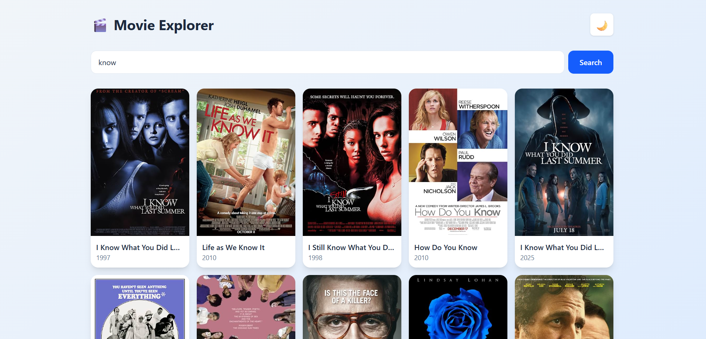
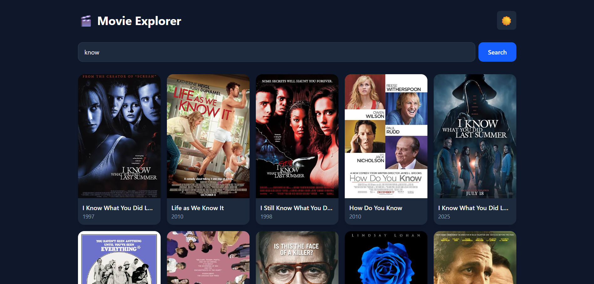

# 🎬 Movie Explorer

A modern, fully responsive movie search application built with **React**, **React Router**, and **Tailwind CSS**. Search for any movie, view detailed information, and browse results with infinite pagination — all powered by the OMDb API.


---


## ✨ Features

- 🔍 **Live Search** — Search for movies, series, and episodes via the OMDb API.
- 📄 **Detailed View** — Click any movie to see its plot, cast, director, ratings, and more.
- 📱 **Fully Responsive** — Beautiful 1-column layout on mobile, 2 on tablets, and 3 on desktop.
- ⚡ **Pagination ("Load More")** — Fetch subsequent pages of results seamlessly without reloading the page.
- ⌛ **Loading States** — Modern, animated skeleton loaders while fetching data.
- ⚠️ **Error Handling** — Graceful fallbacks for missing posters, bad searches, and network errors.
- 🌙 **Dark Mode** — Toggle between light and dark themes (persisted in `localStorage`).
- 💾 **Remember Last Search** — Your last search query is saved and re-run automatically on page refresh.
- 🔒 **Secure API Key** — Uses Vite environment variables to keep your API key safe and out of GitHub.
- 🛡️ **Race Condition Guard** — Prevents React state updates on unmounted components.

---

## 🖼️ Live Demo

<p align="center">
  
  
</p>

Live server : [https://movie-explorer-ashy-zeta.vercel.app](https://movie-explorer-peach-sigma.vercel.app/)

---

## 🛠️ Tech Stack

| Tool | Purpose |
|------|---------|
| **React 19** | UI Library & State Management |
| **Vite** | Build Tool & Development Server |
| **Tailwind CSS 4** | Utility-first Styling & Dark Mode |
| **React Router 7** | Client-side routing (`/` and `/movie/:id`) |
| **OMDb API** | External movie database |

---

## 🚀 Getting Started

### Prerequisites
- **Node.js** 18+ ([download](https://nodejs.org/))
- **npm** (comes with Node)
- A free **OMDb API Key** ([get one here](https://www.omdbapi.com/apikey.aspx))

### Installation

```bash
# 1. Clone the repository
git clone https:[//github.com/YOUR_USERNAME/movie-explorer.git](https://github.com/Irfan916/movie-explorer.git)
cd movie-explorer

# 2. Install dependencies
npm install

# 3. Start the development server
npm run dev
